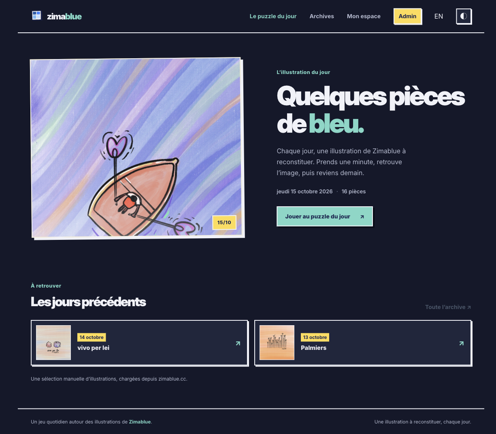

# Puzzle Zimablue

**Un petit puzzle quotidien créé à partir des illustrations de Zimablue.** Tout le monde reconstitue la même image du jour, puis peut retrouver les puzzles précédents dans les archives.

[Jouer à Puzzle Zimablue](https://puzzle.zimablue.cc) · [English](README.md)



*La page d’accueil, capturée le 15 octobre 2026.*

## Fonctionnalités

- Un puzzle commun chaque jour et une archive des jours précédents.
- Un plateau adaptatif qui respecte le format de l’illustration.
- Six niveaux de difficulté quotidiens : 9, 16, 25, 36, 49 ou 64 pièces.
- Des comptes facultatifs pour sauvegarder sa progression et retrouver ses statistiques sur plusieurs appareils.
- Un calendrier d’administration pour sélectionner les illustrations, programmer les puzzles et publier les brouillons.
- Interfaces française et anglaise, thèmes clair et sombre, effets sonores facultatifs.
- Illustrations sélectionnées dans le catalogue public d’images de [Zimablue](https://zimablue.cc).

## Technologies

Nuxt 4, Vue, Una UI, UnoCSS, Cloudflare Workers et D1. L’authentification utilise `nuxt-auth-utils`.

## Versionnage

L’application suit [Semantic Versioning](https://semver.org/) et sa version actuelle apparaît dans le pied de page. Chaque commit qui modifie le comportement, le contenu ou l’apparence de l’application met à jour la version dans `package.json` et `package-lock.json`, puis ajoute une entrée datée dans [`CHANGELOG.md`](CHANGELOG.md). On incrémente la version patch pour les corrections et finitions. Avant `1.0.0`, les nouvelles fonctionnalités et les changements incompatibles font évoluer la version mineure ; `1.0.0` marquera un engagement délibéré envers une expérience centrale stable. Après `1.0.0`, on réserve la version majeure aux changements incompatibles du jeu, des comptes ou de la progression sauvegardée, ou des URL/API publiques. Une fonctionnalité importante mais compatible fait évoluer la version mineure. La documentation seule et la maintenance interne ne font pas évoluer la version. Chaque commit versionné reçoit un tag Git local correspondant (`vX.Y.Z`) ; les tags identifient le code source sans déclencher de déploiement ni de publication.

## Lancer le projet en local

Node.js et npm sont nécessaires.

```sh
npm install
cp .dev.vars.example .dev.vars
```

Modifie `.dev.vars` et définis des valeurs aléatoires uniques pour `NUXT_SESSION_PASSWORD` et `NUXT_ADMIN_BOOTSTRAP_KEY` (au moins 32 caractères chacune). Renseigne dans `NUXT_INITIAL_ADMIN_EMAIL` l’adresse autorisée à créer le premier compte admin. Garde les vraies valeurs dans `.dev.vars` : ce fichier est ignoré par Git.

Initialise la base D1 locale et démarre Nuxt :

```sh
npx wrangler d1 migrations apply puzzle-zimablue --local
npm run dev
```

Ouvre [http://localhost:3001](http://localhost:3001). Le premier compte admin peut être initialisé à `/admin/initialiser` avec la clé de bootstrap.

L’environnement local de Wrangler simule D1 et le binding email. Les emails de récupération de mot de passe sont consignés en local et ne sont pas envoyés.

## Build et vérification des types

```sh
npm run typecheck
npm run build
```

Le build de production utilise le preset `cloudflare-module` de Nuxt. Les ressources et identifiants de production sont gérés dans Cloudflare ; ne les copie pas dans la configuration locale et ne les ajoute pas à Git.

## Illustrations

L’application charge chaque illustration sélectionnée depuis le catalogue public d’images de Zimablue. Le catalogue et les œuvres sont gérés sur [zimablue.cc](https://zimablue.cc).

## Licence

Le code source du projet est publié sous [licence MIT](LICENSE). Les illustrations Zimablue, le nom et le logo Zimablue, ainsi que les captures d’écran de ce dépôt ne sont pas couverts par cette licence et restent tous droits réservés à leurs ayants droit respectifs.
