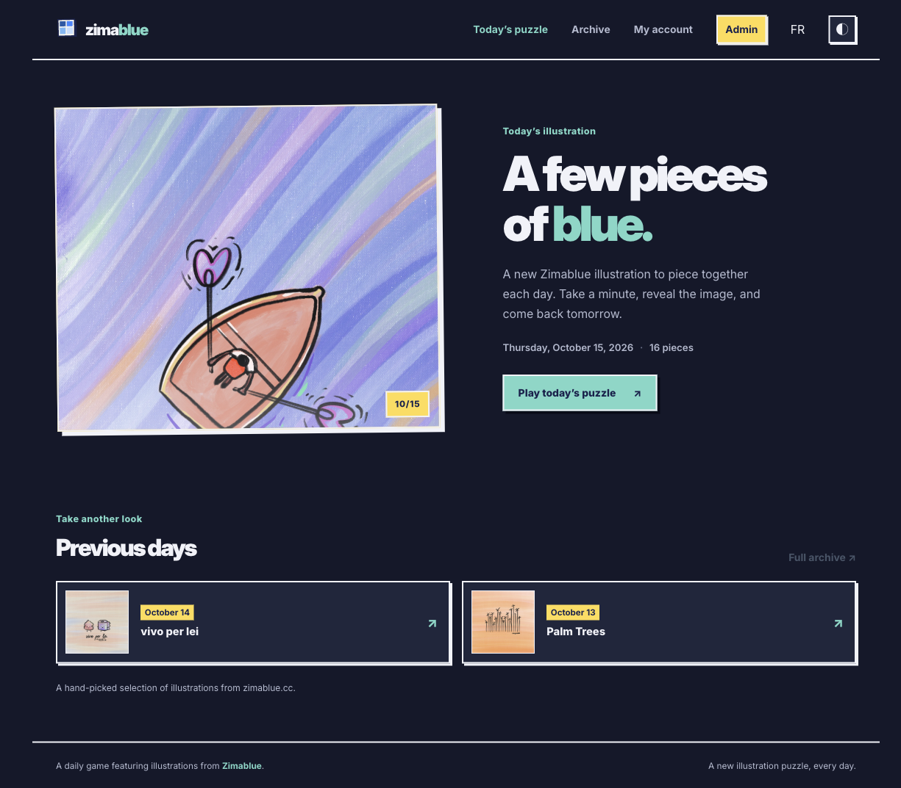

# Puzzle Zimablue

**A small daily puzzle made from illustrations by Zimablue.** Play the same puzzle as everyone else, then revisit earlier days in the archive.

[Play Puzzle Zimablue](https://puzzle.zimablue.cc) · [Français](README.fr.md)



*The home page, captured on 15 October 2026.*

## What it does

- One shared puzzle each day, with an archive of previous puzzles.
- A responsive board that follows the illustration’s aspect ratio.
- Three difficulty levels: 9, 16, or 25 pieces.
- Optional accounts for saving progress and viewing statistics across devices.
- An admin calendar for selecting illustrations, scheduling puzzles, and publishing drafts.
- French and English interfaces, light and dark themes, and optional sound effects.
- Illustrations selected from the public [Zimablue](https://zimablue.cc) image catalogue.

## Built with

Nuxt 4, Vue, Una UI, UnoCSS, Cloudflare Workers, and D1. Authentication uses `nuxt-auth-utils`.

## Versioning

The app follows [Semantic Versioning](https://semver.org/). The current version is recorded in `package.json`; notable changes go in [`CHANGELOG.md`](CHANGELOG.md). For a release, update the changelog, bump the package version, and create a matching Git tag in the form `vX.Y.Z`.

## Run locally

You’ll need Node.js and npm.

```sh
npm install
cp .dev.vars.example .dev.vars
```

Edit `.dev.vars` and set unique random values for `NUXT_SESSION_PASSWORD` and `NUXT_ADMIN_BOOTSTRAP_KEY` (at least 32 characters each). Set `NUXT_INITIAL_ADMIN_EMAIL` to the address allowed to create the first admin account. Keep real values in `.dev.vars`; it is ignored by Git.

Initialize the local D1 database and start Nuxt:

```sh
npx wrangler d1 migrations apply puzzle-zimablue --local
npm run dev
```

Open [http://localhost:3001](http://localhost:3001). The first admin account can be initialized at `/admin/initialiser` with the bootstrap key.

Wrangler’s local environment simulates D1 and the email binding. Password-recovery emails are logged locally and are not sent.

## Build and type-check

```sh
npm run typecheck
npm run build
```

The production build uses Nuxt’s `cloudflare-module` preset. Production resources and credentials are managed in Cloudflare and must not be copied into local configuration or committed.

## Illustrations

The app loads the selected image from Zimablue’s public image catalogue. The image catalogue and its artwork are maintained at [zimablue.cc](https://zimablue.cc).

## License

The project’s source code is available under the [MIT License](LICENSE). Zimablue illustrations, the Zimablue name and logo, and screenshots in this repository are excluded from that license and remain all rights reserved by their respective owners.
